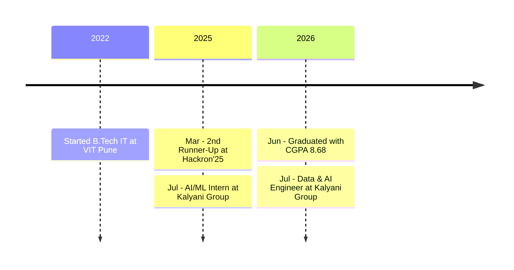

  

  
  
  
  
  

## About

I'm a **Data & AI Engineer at the Kalyani Group** in Pune, India, and a B.Tech IT graduate from **VIT Pune** (CGPA 8.68).
I work across machine learning, backend and frontend, and I enjoy problems where the three meet: a model is only useful once it sits behind a clean API and an interface people want to use.

<table>
  <tr>
    <td align="center" width="25%"><b>3</b> hackathon wins and podiums</td>
    <td align="center" width="25%"><b>#737 / 24K+</b> LeetCode Weekly Contest 428</td>
    <td align="center" width="25%"><b>1550</b> LeetCode contest rating</td>
    <td align="center" width="25%"><b>4</b> apps deployed live</td>
  </tr>
</table>

## Tech stack

<table>
  <tr>
    <td width="18%"><b>Languages</b></td>
    <td></td>
  </tr>
  <tr>
    <td><b>Frontend</b></td>
    <td></td>
  </tr>
  <tr>
    <td><b>Backend & data</b></td>
    <td></td>
  </tr>
  <tr>
    <td><b>Infra & tools</b></td>
    <td></td>
  </tr>
  <tr>
    <td><b>Focus areas</b></td>
    <td>
      
      
      
      
      
      
    </td>
  </tr>
</table>

## Featured work

<table>
  <tr>
    <td width="50%" valign="top">
      <h3><a href="https://github.com/sujitwagh9/Pneumonia-Detection-and-Report-Generation">Pneumonia Detection & Report Generation</a></h3>
      Reads a chest X-ray, flags pneumonia, highlights the evidence with Grad-CAM heatmaps and writes a medical report.
        
      
      
      
      
    </td>
    <td width="50%" valign="top">
      <h3><a href="https://github.com/sujitwagh9/SmartStatementReader">Smart Statement Reader</a></h3>
      An AI system that automates financial data extraction from PDF statements, replacing manual copy-and-paste.
        
      
      
      
    </td>
  </tr>
  <tr>
    <td width="50%" valign="top">
      <h3><a href="https://github.com/sujitwagh9/Animal-Species-Prediction">Animal Species & Pain Detection</a></h3>
      Classifies bird species and detects signs of distress in animal sounds, using MobileNetV2 on spectrograms and MFCC features.
        
      
      
      
    </td>
    <td width="50%" valign="top">
      <h3>Dark Store Network Planner</h3>
      Decides where dark stores should go using demand clustering and Voronoi coverage maps.
      <b>2nd Runner-Up at Hackron'25 (Blinkit).</b>
        
      
      
      
    </td>
  </tr>
  <tr>
    <td width="50%" valign="top">
      <h3><a href="https://github.com/sujitwagh9/Version_Control_System_Simulation">GitSim</a></h3>
      An interactive Git playground: stage, commit, branch and merge with a live commit graph, a simulated terminal, a visual merge-conflict resolver, private per-user sandboxes and Google/GitHub sign-in.
        
      
      
      
      
    </td>
    <td width="50%" valign="top">
      <h3><a href="https://github.com/sujitwagh9/CampusFound">CampusFound</a></h3>
      Helps students and staff report, track and claim lost or found items on campus.
      <a href="https://campusfound-web.onrender.com/"><b>Live demo</b></a>
        
      
      
      
    </td>
  </tr>
</table>

<b>More projects</b>

 

| Project | What it does | Links |
|---|---|---|
| [myportfolio](https://github.com/sujitwagh9/myportfolio) | Portfolio with an AI assistant, job-fit analyzer and semantic search (Next.js, TypeScript, Gemini) | [Live](https://sujitdevport.vercel.app/) |
| [Blog-App](https://github.com/sujitwagh9/Blog-App) | Register, log in and manage articles with JWT authentication | [Live](https://blog-app-ejan.onrender.com) |
| [Stack Smashing Simulator](https://github.com/sujitwagh9/StackSmashingSimulator) | Teaching tool that illustrates, analyzes and visualizes stack-based buffer overflow vulnerabilities | |
| [Anomaly Detector](https://github.com/sujitwagh9/anamoly-detector) | Detects anomalies in time-series datasets | |
| [Course-Aid](https://github.com/sujitwagh9/Course-Aid) | LMS where students enroll, ask instructors doubts and track progress | |
| [KrishiSetu](https://github.com/sujitwagh9/KrishiSetu) | Connects farmers directly to the market | |
| [MiniSearchEngine](https://github.com/sujitwagh9/MiniSearchEngine) | A small text-based search engine | |
| [OperatingSystem](https://github.com/sujitwagh9/OperatingSystem) | Implementations of core operating-system concepts in C++ | |
| [BloodBank](https://github.com/sujitwagh9/BloodBank) | Website for a blood bank | [Live](https://bloodbank-i6yu.onrender.com/) |

## Wins & milestones

<table>
  <tr>
    <td align="center" width="25%"><b>Winner</b> Vodafone Idea Tech Marathon Built a working dashboard in 90 minutes · ₹25,000</td>
    <td align="center" width="25%"><b>Winner</b> Kalyani Group Hackathon One of the top 7 picked for an internship</td>
    <td align="center" width="25%"><b>2nd Runner-Up</b> Hackron'25 by Blinkit Dark Store Network Planner · ₹10,000</td>
    <td align="center" width="25%"><b>Global rank 737</b> LeetCode Weekly 428 Out of 24,000+ participants</td>
  </tr>
</table>

  
   
  Also on GeeksforGeeks (3 star) and CodeChef (2 star)

## Journey

## Currently

- **Building** LLM agents and MCP tools that let people query their data in plain English
- **Learning** agent design, deeper ML, and shipping models behind clean APIs
- **Happy to talk about** hackathon strategy, ML projects, full-stack builds and LeetCode

## GitHub activity

  

  
  

  <picture>
    <source media="(prefers-color-scheme: dark)" srcset="https://raw.githubusercontent.com/sujitwagh9/sujitwagh9/output/github-snake-dark.svg" />
    <source media="(prefers-color-scheme: light)" srcset="https://raw.githubusercontent.com/sujitwagh9/sujitwagh9/output/github-snake.svg" />
    
  </picture>

  

